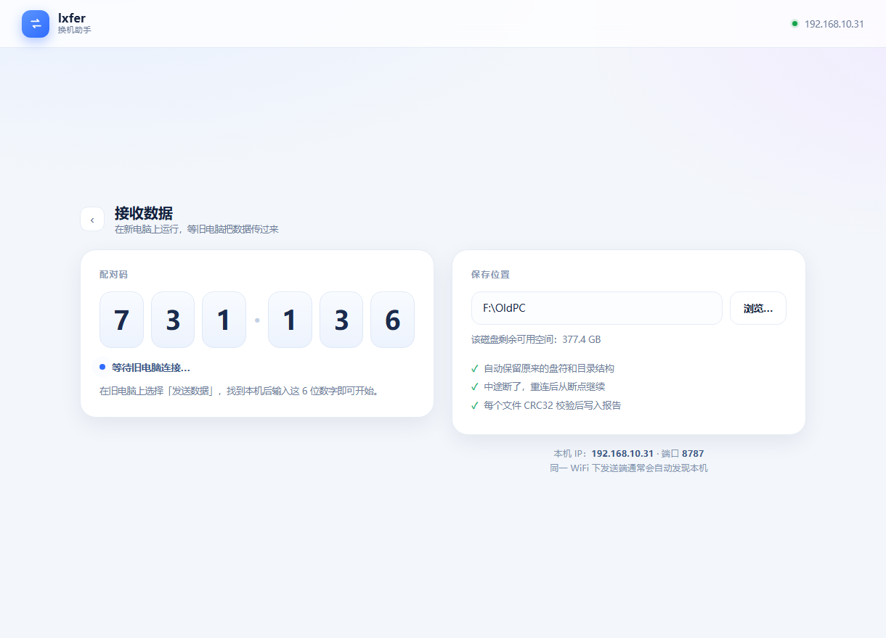
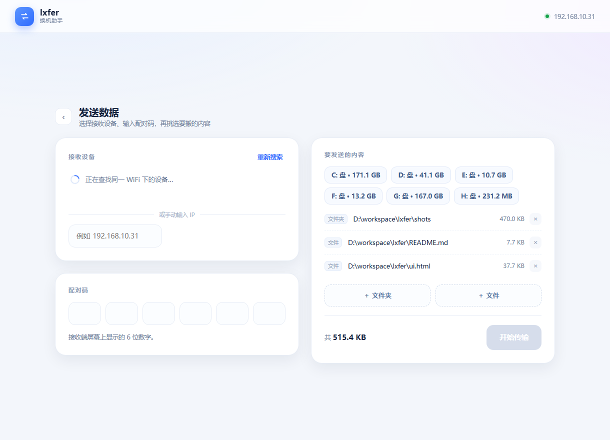
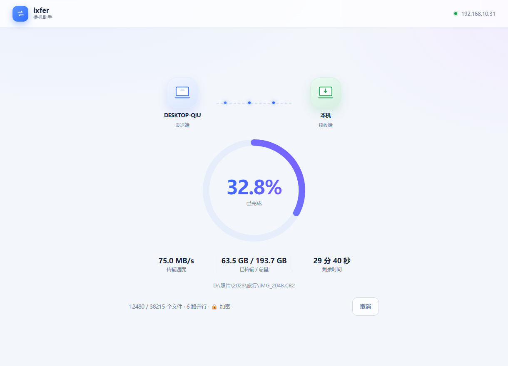

# lxfer v3.1 —— 局域网换机助手（加密 · 多连接并行 · 断线重连）

一个 **~550 KB 的单文件 exe**，两台 Windows 电脑，同一 WiFi 下整盘搬数据。
不用开共享、不用建账户、不用装运行时。

> 两端建议使用同一版本。v3.1 的握手额外带了"已完成连接位图"，对 v3.0 兼容（旧端会忽略该字段）。

| 首页 | 接收端 |
|---|---|
|  |  |

| 发送端 | 传输中 |
|---|---|
|  |  |


---

## 一、v3.1 改动（发送内容选择 + 链路审查修复）

### 1. 「要发送的内容」现在支持单文件

- 新增「＋ 文件」按钮，系统文件选择框，**支持多选**
- 单个文件放到**以它所在文件夹命名的子目录**下，避免散落在目标根目录
  - 例：加 `D:\资料\合同.pdf` → 目标 `F:\OldPC\资料\合同.pdf`
  - 盘根文件 `D:\a.txt` → 目标 `F:\OldPC\D\a.txt`
- 列表里用「文件 / 文件夹」标签区分，大小即时显示

### 2. 自动去重（避免同一批文件被搬两遍）

| 操作 | 结果 |
|---|---|
| 先加 `D:\a`，再加 `D:\a\b` | 提示"已包含在已选内容里"，不重复添加 |
| 先加 `D:\a\b`，再加 `D:\a` | 自动移除 `D:\a\b`，保留父目录 `D:\a` |
| 重复添加同一路径（大小写/末尾斜杠不同也算同一个） | 忽略 |
| 同一文件先单加又加它的父目录 | 自动合并去重 |

### 3. 不同来源同名目录不再互相覆盖

两个来源都叫 `photos`（例如 `D:\照片\photos` 和 `E:\备份\photos`）时，
第二个自动变成 `photos (2)`，目标里清楚分开，不会混在一起或互相覆盖。

### 4. 这轮审查一并修掉的 5 个隐患

| 隐患 | 说明 / 修法 |
|---|---|
| 重连后**空目录丢失** | 之前只在首次连接发送目录列表；改成每次重连都补发（幂等） |
| 接收端重启后**已完成的连接无法确认** | 握手增加"已完成连接位图"，重连时告诉新接收端哪些连接早就干完了，避免任务永远等不齐 |
| 失败文件匹配不准 | 之前用文件名后缀匹配，同名的不同文件会误判；改成 `根目录\相对路径` 精确匹配 |
| 磁盘列表不刷新 | 进入发送/接收页面时重新枚举磁盘，插拔 U 盘后能看到新盘 |
| 重连后**报告账目重复计数** | 之前"跳过"会被重复统计；改成以发送端的逐文件权威统计结算，复制+跳过+失败 恒等于文件总数（即使中途重启接收端） |

---

## 二、v3.0 已有的能力

| 能力 | 说明 |
|---|---|
| 加密传输 | ECDH P-256 + AES-256-GCM，控制消息与数据全加密，用 Windows 自带 bcrypt.dll |
| 配对码绑定密钥 | KDF 混入 6 位配对码，同网段不知道配对码的人拿到握手包也解不开 |
| 断线自动重连 | 每路连接重试 4 次（2/4/6/8 秒退避），从断点继续 |
| 配对码持久化 | `%LOCALAPPDATA%\lxfer\pairing-code.txt`，接收端重启后能自动接上 |
| 磁盘空间预检 | 空间不够直接拒绝并说明差多少 |
| 多连接并行 | 4 / 6 / 8 路自适应 + LPT 按大小均衡 |
| 批量提交 | 128 文件 / 32MB 一批，2 次往返/批 |
| 断点续传 | `.lxferpart`，重连/重跑都从断点继续 |
| 完整性校验 | CRC32 逐文件比对，失败清单进报告 |

---

## 三、实测

| 项目 | 结果 |
|---|---|
| 1505 文件 / 161.5 MB（加密 + 6 路并行） | **1.27 秒**，1505/1505 哈希一致，空目录保留 |
| 断线重连（中途杀接收端） | 自动重连补完；1202 个文件的报告为 复制 939 + 跳过 263 = 1202，**账目精确**，哈希 1202/1202 一致 |
| 正常加密并行（1202 文件 / 60 MB） | 0.69 秒，复制 1202 / 跳过 0，合计 1202 |
| 混合来源：两个同名 photos 目录 + 单文件 | 目标为 `photos`、`photos (2)`、`other/report.pdf`，内容全对 |
| 去重：先子后父 / 先父后子 / 重复添加 | 符合预期并给出提示 |
| 单个文件（`other\report.pdf`） | 落到 `other\report.pdf`，`file=true` 标记正确 |
| 续传 / 跳过 / 中文名 / 空格 / 深路径 | 全部通过 |
| 错误配对码 / 旧版本 / 空间不足 | 立即拒绝并说明原因 |

> 回环速度只说明协议不是瓶颈；真实速度取决于旧电脑 WiFi 与磁盘（v2.0 起小文件往返问题已消除）。

---

## 四、怎么用（旧电脑 D/E/F/G → 本机 F:\OldPC）

1. **把新 `lxfer.exe` 拷到旧电脑**
2. **本机双击** →「接收数据」→ 保存位置默认 `F:\OldPC` → 屏幕显示 6 位配对码
3. **旧电脑双击** →「发送数据」→ 选中本机（找不到就手输 IP）→ 输配对码
   - 点「＋ 文件夹」收集整盘/目录，点「＋ 文件」单独挑文件
   - 或者直接点磁盘快捷按钮 `D: E: F: G:`
4. 「开始传输」→ 完成后看报告 `F:\OldPC\lxfer-report-<时间>.txt`

首次运行：SmartScreen →「更多信息」→「仍要运行」；防火墙 → 勾「专用网络」→ 允许。

---

## 五、已知限制

- 仅 Windows 64 位；界面依赖系统自带 Edge
- 建议两端同版本（v3.1 对 v3.0 握手向后兼容，但行为以新版为准）
- 加密依赖 Windows bcrypt；不可用时降级明文并在界面提示
- 配对码持久化保存（为断线重连）；换人使用前可删 `pairing-code.txt`
- 自动重连上限 4 次，超过后需手动重开（数据会续传）
- 只做复制，不删源文件，不做双向同步；没做定时备份/托盘常驻

## 六、遇到问题

| 现象 | 处理 |
|---|---|
| "协议不匹配" | 两端换成同一个新 exe |
| "目标磁盘空间不足" | 换保存位置或清盘 |
| "这个位置已经包含在已选内容里了" | 说明父目录已在列表，无需重复添加 |
| 找不到设备 | 同网段？公共网络 AP 隔离就手输 IP |
| 个别文件失败 | 源文件被占用，关掉程序重跑 |

## 七、开发说明

- 零第三方依赖：Rust 标准库 + Win32 FFI（bcrypt、磁盘信息），文件/文件夹选择走系统对话框
- 界面：内嵌 HTML/CSS/JS（`ui.html`，编译期打包），本机只监听 `127.0.0.1` 的 HTTP 服务，前端 400ms 轮询
- 源码：`lxfer.rs`、`ui.html`、`dev/crypto_test.rs`（加密链路独立验证）、`cli.rs`（v0.1 存档）
- 编译：

```bat
rustc --edition 2021 -O -C panic=abort -C strip=symbols -o lxfer.exe lxfer.rs
```

- 调试：`--serve`、`--ui-port=18001`、`--demo=home|recv|send|transfer|done`

### 协议一览

```
HELLO2 <code> <name> <jobid> <widx> <count> <pubkey> <totalbytes> <done_mask>
      ← WELCOME <enc> <receiverpub>
      PLAN / ROOT / DIR / BATCH <n> {F <rel> <size> <mtime>}*n BEND
      ← DEC <n> {S | G <offset>}*n DEND
      <加密数据帧>* 0 长度帧 C <crc32>          ← 逐文件
      ← R <失败数> {X <path> <reason>}*
      DONE              ← FINAL <copied> <skipped> <failed> <bytes> <dest>
```

## 八、自测记录

| 测试项 | 结果 |
|---|---|
| 加密 + 并行（1505 文件 / 161.5 MB） | ✅ 1.27s，哈希全一致 |
| 断线重连（中途杀接收端） | ✅ 自动补完，哈希全一致 |
| 单文件 / 混合来源 / 同名目录 | ✅ |
| 去重（子/父/重复） | ✅ 有提示 |
| 续传 / 跳过 / 空目录 / 中文 / 深路径 | ✅ |
| 空间预检 / 错误码 / 旧版本 | ✅ 立即拒绝 |
| 双击启动 / 关窗退出 | ✅ |
